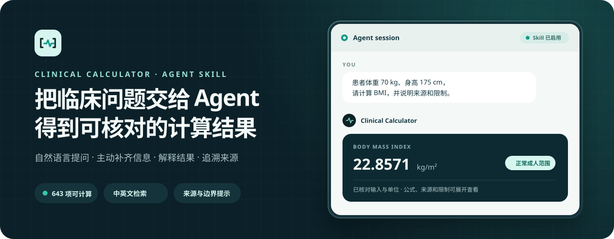
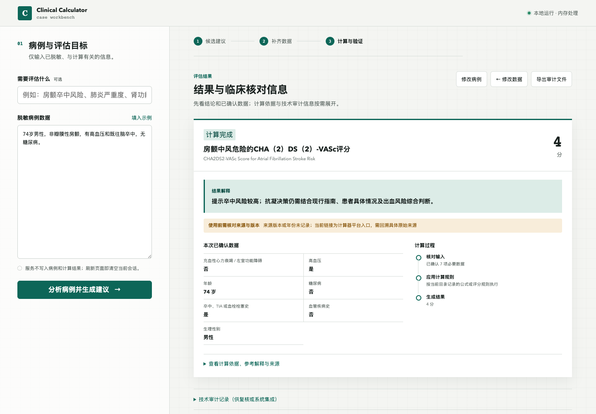
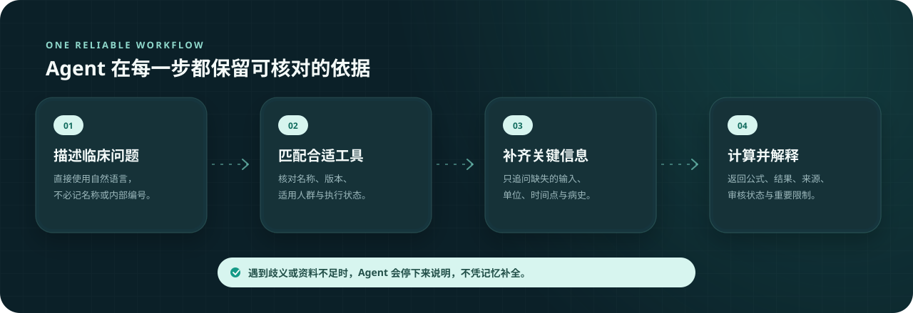

<p align="center">
  <strong>简体中文</strong> · <a href="./README.en.md">English</a>
</p>

<p align="center">
  
</p>

<h1 align="center">Clinical Calculator</h1>

<p align="center">
  
  
  
  
  
  <a href="./LICENSE"></a>
</p>

<p align="center">
  把临床问题或可靠来源资料直接交给 Agent。它可以查找、计算、解释，也可以从资料中整理并验证新的计算器。
</p>

<p align="center">
  <a href="#项目介绍">项目介绍</a> ·
  <a href="#交给-agent-使用">开始使用</a> ·
  <a href="#实际使用">实际使用</a> ·
  <a href="#agent-如何完成一次计算">工作方式</a> ·
  <a href="#安全边界">安全边界</a>
</p>

> [!IMPORTANT]
> 这是一个供支持 Agent Skills 的 AI Agent 使用的医学计算能力库，不是独立诊疗产品。结果用于决策支持、教学与核对，不能替代专业诊断、处方或紧急处置。

## 项目介绍

Clinical Calculator 将分散在官方资料、专业协会、原始文献、临床计算器平台与可追溯研究中的计算规则，整理成 Agent 可以搜索、核对和执行的统一能力。目前收录 **643** 个本地可执行条目，覆盖 **570** 个去重后的计算器名称、**56** 个专业类别，以及清单中登记的 **555** 个不同疾病或临床场景标签。全部条目共关联 **220** 条可追溯来源链接，分布于 **125** 个来源站点域名；每个条目都保留中英文名称、输入要求、实现类型以及仓库当前记录的来源与链接。

除了使用已有目录，用户也可以把指南、论文、公式说明、表格或其他可靠素材交给 Agent。Skill 支持从 JSON、CSV、Markdown、PDF、DOCX 和书面规则中提取明确的输入、单位、公式、查表或决策树，先生成草稿并验证，再由用户确认是否安装为新的自定义计算器。

资料已收录或计算逻辑可以执行，并不代表其版本、适用人群、授权状态或临床发布状态已经通过独立审核。本目录是国际性而非特定国家的集合：来源资料主要以英文记录，但使用每个计算器前仍需核对其原始验证人群、地区单位和当地现行指南。

## 交给 Agent 使用

1. 在支持 Agent Skills 的工具中添加或打开本仓库。
2. 用自然语言说明你要解决的临床问题；已有的患者信息可以一起提供。
3. Agent 会选择合适的计算器。遇到缺失信息、同名版本或适用人群不明确时，它会先向你确认，再给出结果。

你可以直接这样说：

| 你想做什么 | 告诉 Agent |
| --- | --- |
| 找到合适的工具 | “帮我找一下评估房颤卒中风险的计算器，并告诉我需要哪些信息。” |
| 完成一次计算 | “患者体重 70 kg、身高 175 cm，计算 BMI，并说明公式、结果、来源和限制。” |
| 核对评分过程 | “请逐项核对 CURB-65，不确定的项目先问我，不要自行假设。” |
| 增加新的计算器 | “我会提供一份指南或论文，请把其中明确的公式整理成可验证的自定义计算器，安装前先让我确认。” |

不需要知道计算器的准确名称或任何技术细节。描述问题即可，搜索、选择和执行由 Agent 完成。

### 本地病例工作台

仓库同时提供一个零新增运行依赖的本地工作台，用于“输入脱敏病例 → 自动发现可能适用的计算器/量表 → 查看候选与证据 → 人工勾选 → 补齐缺失数据 → 计算并导出审计日志”。评估目标是可选项：留空时按病例线索发现评估方向，填写后则用目标约束推荐。

```bash
python3 scripts/clinical_workbench.py --open
```

默认地址为 `http://127.0.0.1:8765`。病例数据和结果只在当前浏览器页面与 Python 进程内存中处理，服务不写入文件；下载审计 JSON 是使用者主动触发的本地操作。当前候选来自仓库已经整理的本地证据目录，并非实时联网文献检索。界面会明确展示来源是否具体、版本是否缺失及自动化审核缺口；“可执行”不代表已经临床发布。

病例驱动推荐使用保守、可解释的临床线索发现“评估机会”，不会把线索当作诊断，也不会绕过人工选择自动计算。这个仓库更适合作为完整临床工作流中的计算与验证组件：上游可连接病历脱敏、EHR/FHIR 结构化、术语标准化和指南/文献 RAG；下游可连接临床审核、权限控制、电子签名、审计归档和结果回写。单独使用适合本地演示、教学与人工核对，不能替代这些生产级系统。

## 实际使用

下面两张图来自本地病例工作台的真实浏览器运行过程，使用仓库当前的检索结果、输入契约与计算实现。

### 只输入病例：自动发现评估方向与候选工具

<p align="center">
  
</p>

工作台从房颤病例中识别“卒中风险”和“抗凝相关出血风险”两个评估方向，并分别展示候选工具、推荐原因、缺失输入、来源与审核缺口。计算器仍需由使用者明确勾选。

### 补齐缺失数据：计算并展示可验证轨迹

<p align="center">
  
</p>

示例在使用者确认缺失项后得到 CHA₂DS₂-VASc 4 分。结果页同时保留输入快照、验证状态、公式、结果和来源审核缺口，可下载完整审计 JSON 复核。

## Agent 如何完成一次计算

<p align="center">
  
</p>

关键原则是“先核对，再计算”：

- 同名评分存在不同版本或适用人群时，Agent 不会静默代选。
- 输入、单位或时间点不明确时，Agent 会追问，不会自行补全。
- 请求的计算器未被收录时，Agent 会明确说明，不会凭记忆临时拼出公式。
- 返回结果时会同时给出计算器、输入、公式或规则、结果、解释、来源和重要限制。

## 能处理什么

- 搜索中英文临床计算器、评分、分期、肾功能估算、实验室衍生指标与单位换算。
- 根据明确输入完成计算，并保留可复核的计算过程。
- 区分相似名称、不同版本、成人与儿童等适用范围。
- 对输入不完整、单位不明确或超出边界的情况给出明确提示。
- 从你提供的指南、论文、表格或规则文件中整理自定义公式、查表或决策树；验证通过并经你确认后再安装。

## 当前覆盖

主目录只收录具备本地计算逻辑和明确输入契约的内容：共 **643** 个可执行条目，覆盖 **570** 个唯一中文名称。其中 593 个可以从原始输入完成计算，50 个用于需要预评分组件或上游结果的中间计算。

仓库不保留只有名称、缺少公式、属于指南知识或受授权限制的不可执行条目。可执行仍不等同于已经获得临床发布批准。

## 已支持的计算器

[查看完整计算器目录](./CALCULATORS.md)，可按专业类别浏览全部 643 个可执行条目。目录逐项列出中英文名称、实现类型以及仓库当前记录的来源与链接。

## 结果里会说明什么

一次完整回答通常包括：

- 使用的计算器与版本
- 输入值、单位和必要的换算
- 公式、计分规则或查表依据
- 结果、取整方式与适用的解释
- 来源链接及当前审核状态
- 适用人群、已知限制与需要专业复核的事项

## 自定义计算器

如果权威资料中的计算规则尚未收录，可以直接把 JSON、CSV、Markdown、PDF、DOCX、指南、论文、表格或书面规则交给 Agent。Agent 只提取资料中明确写出的输入、单位、边界、公式、表格、版本和已知答案；不会凭记忆补齐缺失的系数或阈值。

处理流程为：识别材料中的规则，生成自定义计算器草稿，验证结构与来源案例，再向用户展示拟收录的输入、规则、来源和测试。只有在用户确认后才会安装；材料不完整时会保留为不可执行草稿，并明确指出缺少的内容。患者身份信息和病例数据不会写入计算器定义。

## 安全边界

- 高风险场景必须结合患者状态、完整指南和专业人员判断。
- 药物剂量计算与具体处方决策必须分开，并由临床医生或药师复核。
- 自定义计算器即使能够运行，也不代表已经通过独立临床审核。
- MIT 许可只覆盖仓库自身内容，不自动授予第三方问卷、专有表格或分期内容的再分发权。
- 若输入不足、存在歧义或超出声明边界，Agent 应停止计算并明确说明，而不是生成看似可信的结果。

## 社区

[**LINUX DO — 中文开发者社区**](https://linux.do/)

## License

[MIT](./LICENSE) © Clinical Calculator contributors
